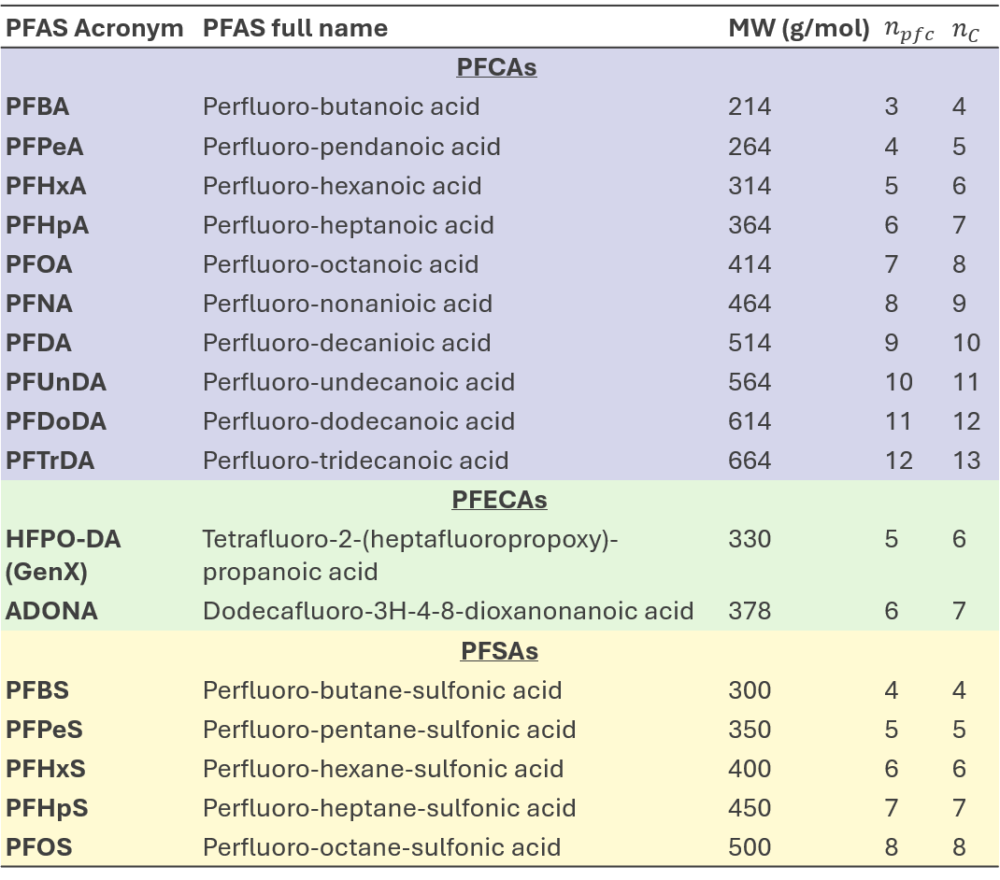
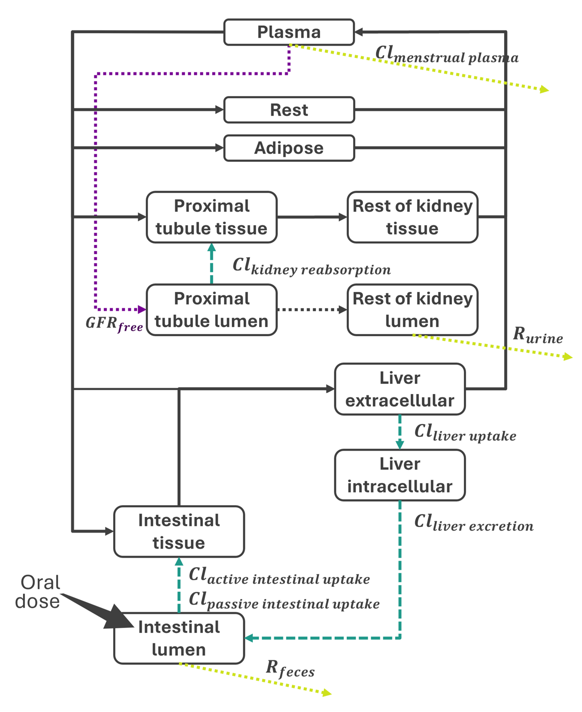

# PFAS NG-PBK model

This repository contains all files needed to run the NG-PBK model for the 17 PFAS found in Table 1. Information about the development and evaluation of the model can be found in Pachoulide et al. (xxxx) "Drivers of toxicokinetic differences between 17 PFAS in humans revealed by next generation physiologically based kinetic modeling", <DOI:xxxxxxxxxxxxxxxxxxxxxxx>

# Git-hub file structure:

## Input folder:
- Physio_Parameters: physiological parameters for an average adult human
- QSPR_Parameters_4MCandGSA: QSPR predicted parameters used when running the NG-PBK model over the range of predicted values to understand the uncertainty derived from these parameters, and in the sensitivity analysis
- Final_TK_Parameters: toxicokinetic parameters used in the NG-PBK model
- Evaluation_data: data collected from human biomonitoring and volunteer studies, used as benchmark to the model predictions
- nC_MW_df: table with the number of carbons and molecular weight of PFAS
- PFAS_ADME_NAM_database: database with all collected ADME data on PFAS derived in in vitro and in silico studies
- TissueComposition: tissue composition in humans

## Script folder:
- QSPRs_4_PBK_model_parameters: where QSPRs are developed
- functions_NG_PBK_model: where the PBK model functions are found
- functions_calculate_results: where the functions to calculate half-lifes, elimination clearances, fraction absorbed and internal PFAS concentrations are
- Run_NG_PBK_model_with_QSPR_params_and_MC: where the uncertainty in NG-PBK model predictions driven by the uncertainty of QSPR parameters is estimated
- eFAST: where the script for running eFAST can be found
- Morris: where the script for running the Morris test can be found
- Run_NG_PBK_model_2estimate_PFAS_TK: where the differences in the NG-PBK model predicted toxicokinetics of PFAS in humans are estimated
- Plots4manuscript: code for producing the plots found in the manuscript

## Output:
Collection of all outputs produced by running the above scripts

## ManuscriptPlots:
Collection of all the plots found in the manuscript

# Packages:

1.  here
2.  tidyverse
3.  deSolve
4.  sensitivity
5.  lhs
6.  glue
7.  patchwork

# The NG-PBK model

## Base structure

The basic PBK model specifies the organs that are necessary to describe the toxicokinetics of PFAS.

(Semi-permeability limited liver and intestine) Entero-hepatic circulation is modelled as: - Passive/active uptake from the intestinal lumen to the intestine (vascular and cellular). - Transfer to the liver extracellular space (vascular and interstitial space) via the portal plasma flow. - Active, OATP transporter mediated and albumin facilitated, uptake to hepatocytes. - Active, BSEP mediated excretion to the intestinal lumen from the hepatocytes. Physiologically, a fraction of billiary secretion is stored in the gallbladder and released after food consumption. For model simplification and as simulations are on the yearly scale, it was decided to assume direct excretion back to the intestinal lumen. - Fecal excretion based on physiological colonic transit time of luminal contents.

(Sequential, semi-permeability limited kidney) Renal secretion and re-absorption is modelled as: - Glomerular filtration of the fraction unbound of PFOA in plasma to the proximal tubuly lumen, forming the primary urine. - Active, OAT4 transported mediated and albumin facilitated, re-uptake to the proximal tubule (vascular and cellular). - Passive (kidney plasma flow driven) flow of PFAS from the proximal tubule to the rest of the kidney structures (loop of Henle, Distal tubule, Collecting duct), and then back to the systemic circulation. - Passive (tubular fluid flow driven) flow of PFAS from the proximal tubule lumen to the lumen of the rest of the kidney structures. - Renal excretion, from the lumen of the rest of the kindey structures to the urine, based on the physiological urinary flow rate.

PFAS excretion via menstrual plasma clearance is also simulated, as well as serum albumin variation throughout lifestage.

Given the affinity of PFOA to different type of lipids, a simple adipose compartment is also added. All other organs are lumped together in a "rest" compartment.

